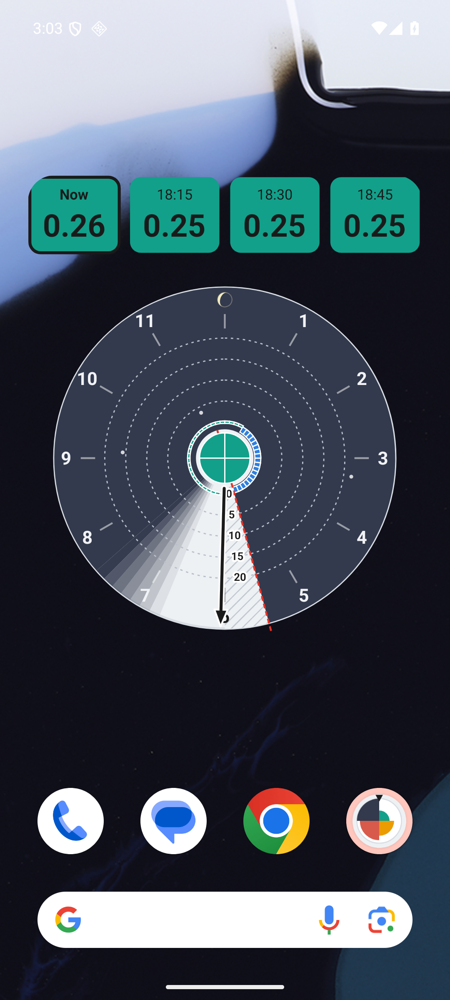
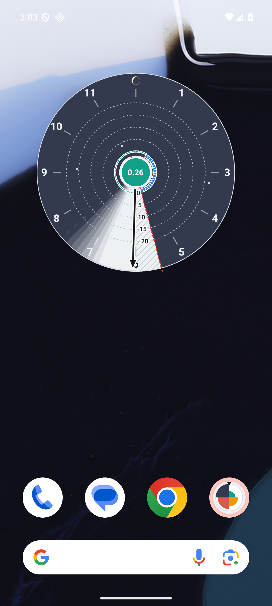

# vartit – Hintakello Androidille

Aloitusnäytön widget, joka näyttää pörssisähkön hinnat seuraaville 12 tunnille
kellotauluna – sama hintakello kuin [vartit.fi](https://vartit.fi):ssä. Hinnat
ovat Suomen (FI) vartin hintoja sentteinä per kWh, alv 25,5 % mukaan lukien.

Tämä repo on pelkkä **jakelukanava**: täältä ladataan valmis APK. Sovelluksen
lähdekoodi on erillisessä yksityisessä repossa.

> **Testiversio.** Sovellus ei ole Google Playssä. Palaute on tervetullutta –
> ks. [Palaute](#palaute).

| Korkea widget | Matala widget |
|---|---|
|  |  |

## Lataus

**Uusin versio:** <https://github.com/19115953/vartit-android/releases/latest/download/vartit.apk>

Linkki osoittaa aina uusimpaan versioon, joten sen voi jakaa sellaisenaan.
Kaikki versiot ja muutokset: [Releases](https://github.com/19115953/vartit-android/releases)
ja [CHANGELOG.md](CHANGELOG.md).

Vaatii Android 8.0:n tai uudemman.

## Asennus

1. Avaa yllä oleva latauslinkki puhelimella.
2. Avaa ladattu `vartit.apk` (ilmoituksesta tai Lataukset-kansiosta).
3. Puhelin kysyy lupaa asentaa sovelluksia tästä lähteestä (selain tai
   tiedostonhallinta) – salli se ja palaa takaisin. Tämä on normaalia, kun
   sovellus ei tule Play-kaupasta.
4. Jos Google Play Protect varoittaa tuntemattomasta sovelluksesta, valitse
   *Lisätietoja* → *Asenna silti*.
5. Avaa **vartit**-sovellus ja paina **Lisää aloitusnäytölle**. (Tai: paina
   aloitusnäyttöä pitkään → *Widgetit* → *vartit* → *Hintakello*.)

### Widgetin koko

Widgetin kokoa voi muuttaa: paina sitä pitkään ja vedä reunoista.

- **Korkea** (selvästi korkeampi kuin leveä): kellon yläpuolelle tulee rivi,
  jossa nykyinen vartti (*Nyt*) ja kolme seuraavaa varttia isolla.
- **Matala tai neliö**: pelkkä kello, nykyinen hinta kellon keskellä.

### Kellon lukeminen

- Kello kattaa seuraavat 12 tuntia, ja musta osoitin näyttää nykyhetken.
- Jokainen palkki on yksi vartti: mitä pidempi palkki, sitä kalliimpi.
  Katkoviivarenkaat ovat 0, 5, 10, 15 ja 20 snt/kWh.
- Värit: **sininen** = negatiivinen hinta (alle 0), **vihreä** = halpa
  (0–2 snt), **oranssi** = keskihintainen (2–10 snt), **punainen** = kallis
  (vähintään 10 snt).
- Tumma tausta on yö. Viivoitettu alue tarkoittaa, ettei hintoja ole vielä
  julkaistu (Nord Pool julkaisee huomisen hinnat iltapäivällä).
- `<0,00` tarkoittaa hintaa, joka on alle nollan mutta niin pieni, että se
  pyöristyisi nollaksi.
- Widgetin napauttaminen avaa vartit.fi:n.

### Jos kello ei päivity

Widget päivittyy itsestään joka vartti ja hakee uudet hinnat noin puolen tunnin
välein. Jotkin puhelimet (erityisesti Samsung) voivat nukuttaa sovelluksia
virransäästön vuoksi. Avaa silloin vartit-sovellus → **Avaa sovellustiedot** →
*Akku* → **Ei rajoituksia**.

## Päivitys

Lataa uusi APK samasta linkistä ja asenna se vanhan päälle. Widget ja
asetukset säilyvät. (Sovellus ei päivity itsestään.)

## Poisto

Poista sovellus kuten minkä tahansa muun: paina kuvaketta pitkään →
*Poista asennus*.

## Tietosuoja

- Sovellus hakee vain hintatiedot osoitteesta `https://vartit.fi/api/prices`.
  Se ei lähetä mitään tietoja sinusta tai puhelimestasi.
- Ei mainoksia, ei analytiikkaa, ei kirjautumista.
- Käyttöoikeudet: internet, verkon tila (hakee vain, kun yhteys on) ja
  käynnistyksen jälkeinen ajastus (widget jatkaa päivittymistä
  uudelleenkäynnistyksen jälkeen).

## Tarkistus (vapaaehtoinen)

Jokaisen julkaisun mukana on `SHA256SUMS`. Kaikki versiot on allekirjoitettu
samalla avaimella:

```
Allekirjoittaja:  CN=vartit, O=vartit.fi, C=FI
Varmenteen SHA-256: 327e0b15744b391fa0ce6c8869bfd3f08ba5738c411d67c83bab8f0c1b00b34a
```

Android tarkistaa itse, että päivitys on allekirjoitettu samalla avaimella kuin
asennettu versio, ja kieltäytyy asentamasta muuta.

## Palaute

Avaa [issue](https://github.com/19115953/vartit-android/issues) (vaatii
GitHub-tilin) tai kerro suoraan sovelluksen jakajalle. Hyödyllisintä on kertoa
puhelimen malli, Android-versio ja mieluiten kuvakaappaus.

---

## In English

A home-screen widget showing Finnish electricity spot prices for the next 12
hours as a clock, the same price clock as [vartit.fi](https://vartit.fi)
(c/kWh, 25.5 % VAT included). This repo only distributes the APK; the source is
in a separate private repository.

- **Download (always the latest):** <https://github.com/19115953/vartit-android/releases/latest/download/vartit.apk>
- **Requires** Android 8.0+.
- **Install:** open the APK, allow installs from your browser/file manager when
  asked (and *Install anyway* if Play Protect warns), then open the app and tap
  **Add to home screen**.
- **Sizes:** resize the widget taller than wide to get a row with the current
  and next three quarter-hour prices above the clock; otherwise the current
  price sits in the clock's centre.
- **Colours:** blue = negative, green = cheap (0–2 c), orange = medium
  (2–10 c), red = expensive (10 c or more). Hatching = not yet published.
- **Not updating?** App → *Open app info* → *Battery* → *Unrestricted*.
- **Update:** install the new APK over the old one. **Privacy:** it only
  fetches `https://vartit.fi/api/prices`; no ads, analytics or accounts.
- **Signing certificate SHA-256:**
  `327e0b15744b391fa0ce6c8869bfd3f08ba5738c411d67c83bab8f0c1b00b34a`

## Julkaiseminen (ylläpitäjälle)

`scripts/publish.sh <versio>` (esim. `0.4.0`) kopioi yksityisen repon
CI:n allekirjoittaman APK:n `android-<versio>` -julkaisusta tänne: tarkistaa
allekirjoitusvarmenteen, laskee `SHA256SUMS`:n, ottaa julkaisutiedotteen
`CHANGELOG.md`:n vastaavasta osiosta ja liittää APK:n sekä versioidulla
(`vartit-<versio>.apk`) että pysyvällä nimellä (`vartit.apk`), jotta
*latest*-linkki toimii aina. Kirjoita CHANGELOG-osio ennen ajoa.
