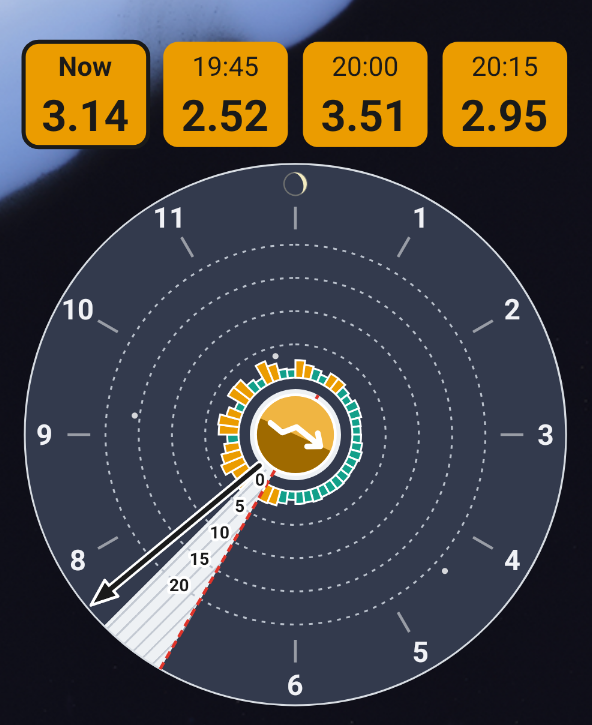
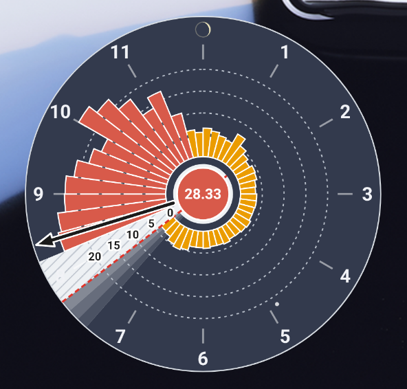
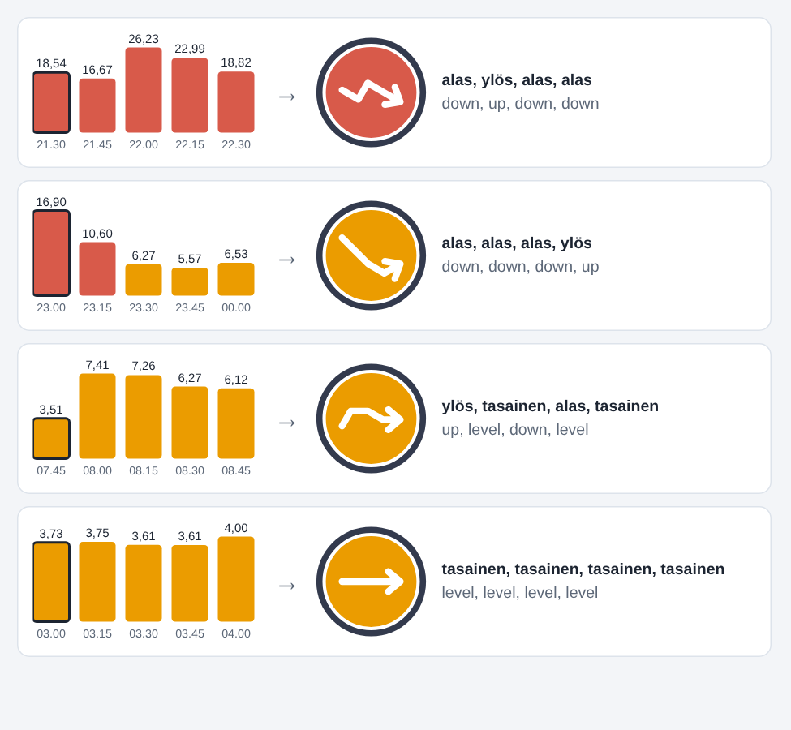

# vartit – Hintakello Androidille

Aloitusnäytön widget, joka näyttää pörssisähkön hinnat seuraaville 12 tunnille
kellotauluna – sama hintakello kuin [vartit.fi](https://vartit.fi):ssä. Hinnat
ovat Suomen (FI) vartin hintoja sentteinä per kWh, alv 25,5 % mukaan lukien.

Tämä repo on pelkkä **jakelukanava**: täältä ladataan valmis APK. Sovelluksen
lähdekoodi on erillisessä yksityisessä repossa.

> **Testiversio.** Sovellus ei ole Google Playssä. Palaute on tervetullutta –
> ks. [Palaute](#palaute).

| Korkea widget | Matala widget |
|---|---|
|  |  |

*Kuvakaappaukset versiosta 0.12.1, 12.11.2026 klo 19.41.*

## Lataus

**Uusin versio:** <https://github.com/19115953/vartit-android/releases/latest/download/vartit.apk>

Linkki osoittaa aina uusimpaan versioon, joten sen voi jakaa sellaisenaan.
Kaikki versiot ja muutokset: [Releases](https://github.com/19115953/vartit-android/releases)
ja [CHANGELOG.md](CHANGELOG.md).

Vaatii Android 8.0:n tai uudemman.

## Asennus

1. Avaa yllä oleva latauslinkki puhelimella.
2. Avaa ladattu `vartit.apk` (ilmoituksesta tai Lataukset-kansiosta).
3. Puhelin kysyy lupaa asentaa sovelluksia tästä lähteestä (selain tai
   tiedostonhallinta) – salli se ja palaa takaisin. Tämä on normaalia, kun
   sovellus ei tule Play-kaupasta.
4. Jos Google Play Protect varoittaa tuntemattomasta sovelluksesta, valitse
   *Lisätietoja* → *Asenna silti*.
5. Avaa **vartit**-sovellus ja paina **Lisää aloitusnäytölle**. (Tai: paina
   aloitusnäyttöä pitkään → *Widgetit* → *vartit* → *Hintakello*.)

### Widgetin koko

Widgetin kokoa voi muuttaa: paina sitä pitkään ja vedä reunoista.

- **Korkea** (selvästi korkeampi kuin leveä): kellon yläpuolelle tulee rivi,
  jossa nykyinen vartti (*Nyt*) ja kolme seuraavaa varttia isolla, ja kellon
  keskellä on seuraavan tunnin hintapolku siksak-nuolena (ks. alla).
- **Matala tai neliö**: pelkkä kello, nykyinen hinta kellon keskellä.

### Siksak-nuoli: seuraavan tunnin hintapolku

Korkean widgetin keskellä oleva nuoli on kuin pieni pala hintakäyrää. Se
kulkee vasemmalta oikealle kuin aika, ja jokainen sen osa on yksi vartti:
nyt → 1. → 2. → 3. → 4. vartti, eli seuraava tunti. Nuolenkärki on tunnin
lopussa.

- Osa **nousee**, jos vartti on kalliimpi kuin edellinen, ja **laskee**, jos
  halvempi. **Vaakasuora** osa = suunnilleen sama hinta (alle 0,5 snt muutos).
- Mitä suurempi muutos **suhteessa hintaan**, sitä jyrkempi osa: alle 10 %,
  10–25 %, 25–50 % tai yli 50 % (15°, 30°, 45°, 60°). Siksi 6 → 12 snt ja
  30 → 60 snt piirtyvät yhtä jyrkkinä – rahamäärän näet hintariviltä.
  Halvoilla tunneilla muutosta verrataan kuitenkin vähintään 5 senttiin, jotta
  sentin parin heilahdus lähellä nollaa ei näytä jyrkältä.
- **Keinohorisontti:** koko siksak on kallistettu sen mukaan, mihin hinta on
  tunnin lopussa menossa nykyiseen verrattuna, ja pallon tausta on jaettu
  samaan kulmaan vaaleaan "taivaaseen" ja tummaan "maahan" – kuin lentokoneen
  keinohorisontti. Vaakasuora horisontti = tunnin lopussa suunnilleen sama
  hinta; kallistus 15°, 25°, 35° tai 45° sen mukaan, onko muutos alle 10 %,
  10–25 %, 25–50 % vai enemmän.
- Pallon väri on seuraavan tunnin keskihinnan väri.



Ylin esimerkki: klo 21.30 hinta ensin laskee (16,67), sitten hyppää (26,23)
ja laskee taas – nuoli kulkee *alas, ylös, alas, alas*. Tunnin lopussa hinta
(18,82) on melkein sama kuin nyt (18,54), joten horisontti on vaakasuora.

### Kellon lukeminen

- Kello kattaa seuraavat 12 tuntia, ja musta osoitin näyttää nykyhetken.
- Jokainen palkki on yksi vartti: mitä pidempi palkki, sitä kalliimpi.
  Katkoviivarenkaat ovat 0, 5, 10, 15 ja 20 snt/kWh. Korkeiden palkkien
  kohdalla renkaat näkyvät palkkien välisissä raoissa pieninä tummina
  viivoina.
- Vähintään 30 snt/kWh:n palkkiin on kirjoitettu hinta kokonaisina sentteinä
  (paitsi nykyiseen varttiin, jonka päällä osoitin on – sen hinta näkyy
  hintarivissä tai kellon keskellä). Hyvin kalliina päivinä kello pienenee
  hieman, jotta pisimmätkin palkit mahtuvat kokonaan näkyviin.
- Värit: **sininen** = negatiivinen hinta (alle 0), **vihreä** = halpa
  (0–2 snt), **oranssi** = keskihintainen (2–10 snt), **punainen** = kallis
  (vähintään 10 snt).
- Tumma tausta on yö. Viivoitettu alue tarkoittaa, ettei hintoja ole vielä
  julkaistu (Nord Pool julkaisee huomisen hinnat iltapäivällä).
- `<0,00` tarkoittaa hintaa, joka on alle nollan mutta niin pieni, että se
  pyöristyisi nollaksi.
- Widgetin napauttaminen avaa vartit.fi:n.

### Jos kello ei päivity

Widget päivittyy itsestään joka vartti ja hakee uudet hinnat noin puolen tunnin
välein. Jotkin puhelimet (erityisesti Samsung) voivat nukuttaa sovelluksia
virransäästön vuoksi. Avaa silloin vartit-sovellus → **Avaa sovellustiedot** →
*Akku* → **Ei rajoituksia**.

## Päivitys

Lataa uusi APK samasta linkistä ja asenna se vanhan päälle. Widget ja
asetukset säilyvät. (Sovellus ei päivity itsestään.)

## Poisto

Poista sovellus kuten minkä tahansa muun: paina kuvaketta pitkään →
*Poista asennus*.

## Tietosuoja

- Sovellus hakee vain hintatiedot osoitteesta `https://vartit.fi/api/prices`.
  Se ei lähetä mitään tietoja sinusta tai puhelimestasi.
- Ei mainoksia, ei analytiikkaa, ei kirjautumista.
- Käyttöoikeudet: internet, verkon tila (hakee vain, kun yhteys on) ja
  käynnistyksen jälkeinen ajastus (widget jatkaa päivittymistä
  uudelleenkäynnistyksen jälkeen).

## Tarkistus (vapaaehtoinen)

Jokaisen julkaisun mukana on `SHA256SUMS`. Kaikki versiot on allekirjoitettu
samalla avaimella:

```
Allekirjoittaja:  CN=vartit, O=vartit.fi, C=FI
Varmenteen SHA-256: 327e0b15744b391fa0ce6c8869bfd3f08ba5738c411d67c83bab8f0c1b00b34a
```

Android tarkistaa itse, että päivitys on allekirjoitettu samalla avaimella kuin
asennettu versio, ja kieltäytyy asentamasta muuta.

## Palaute

Avaa [issue](https://github.com/19115953/vartit-android/issues) (vaatii
GitHub-tilin) tai kerro suoraan sovelluksen jakajalle. Hyödyllisintä on kertoa
puhelimen malli, Android-versio ja mieluiten kuvakaappaus.

---

## In English

A home-screen widget showing Finnish electricity spot prices for the next 12
hours as a clock, the same price clock as [vartit.fi](https://vartit.fi)
(c/kWh, 25.5 % VAT included). This repo only distributes the APK; the source is
in a separate private repository.

- **Download (always the latest):** <https://github.com/19115953/vartit-android/releases/latest/download/vartit.apk>
- **Requires** Android 8.0+.
- **Install:** open the APK, allow installs from your browser/file manager when
  asked (and *Install anyway* if Play Protect warns), then open the app and tap
  **Add to home screen**.
- **Sizes:** resize the widget taller than wide to get a row with the current
  and next three quarter-hour prices above the clock, and a zigzag arrow in
  the centre (below). Otherwise the current price sits in the clock's centre.
- **Zigzag arrow:** the coming hour's price path, read left to right like time:
  one leg per quarter (now → 1st → … → 4th), rising or falling against the
  previous quarter, steeper for a bigger change relative to the price (under
  10 %, 10–25 %, 25–50 %, more: 15/30/45/60°; cheap hours are measured against
  at least 5 c, so a cent's wobble near zero stays gentle); level = about the
  same (under 0.5 c). The arrowhead is the end of the hour; the disc has the next hour's
  average price colour. The whole zigzag, and the disc's lighter "sky" and
  darker "ground" behind it, tilt with where the price ends up at the end of
  the hour, like an aircraft's artificial horizon (level, or 15/25/35/45° for
  under 10 / 25 / 50 / over 50 %). See the picture above: at 21.30 on 11.11.
  it runs *down, up, down, down* on a level horizon.
- **Reading the clock:** each bar is a quarter-hour, longer = pricier; dashed
  rings at 0/5/10/15/20 c, shown as small dark marks in the gaps between tall
  bars. Bars of 30 c or more have their price printed on them in whole cents
  (except the current quarter, under the hand). On very expensive days the
  clock shrinks a little so the longest bars fit.
- **Colours:** blue = negative, green = cheap (0–2 c), orange = medium
  (2–10 c), red = expensive (10 c or more). Hatching = not yet published.
- **Not updating?** App → *Open app info* → *Battery* → *Unrestricted*.
- **Update:** install the new APK over the old one. **Privacy:** it only
  fetches `https://vartit.fi/api/prices`; no ads, analytics or accounts.
- **Signing certificate SHA-256:**
  `327e0b15744b391fa0ce6c8869bfd3f08ba5738c411d67c83bab8f0c1b00b34a`

## Julkaiseminen (ylläpitäjälle)

`scripts/publish.sh <versio>` (esim. `0.4.0`) kopioi yksityisen repon
CI:n allekirjoittaman APK:n `android-<versio>` -julkaisusta tänne: tarkistaa
allekirjoitusvarmenteen, laskee `SHA256SUMS`:n, ottaa julkaisutiedotteen
`CHANGELOG.md`:n vastaavasta osiosta ja liittää APK:n sekä versioidulla
(`vartit-<versio>.apk`) että pysyvällä nimellä (`vartit.apk`), jotta
*latest*-linkki toimii aina. Kirjoita CHANGELOG-osio ennen ajoa.
